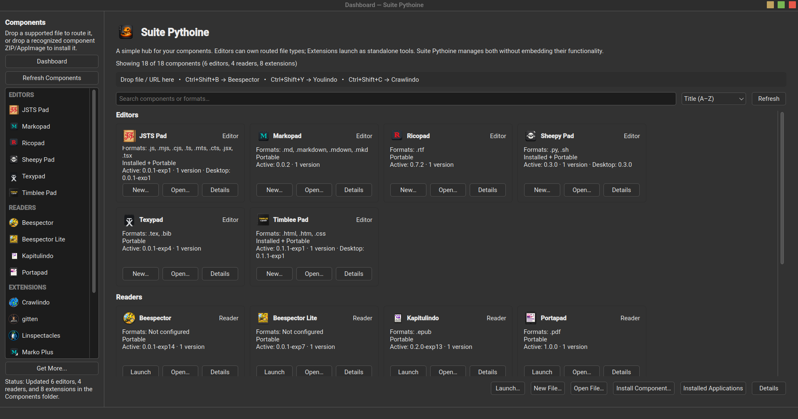
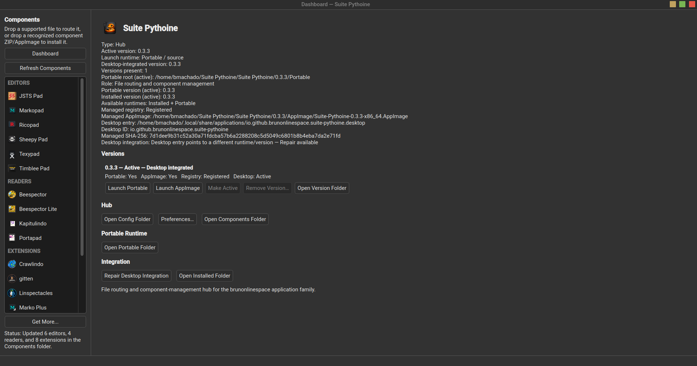
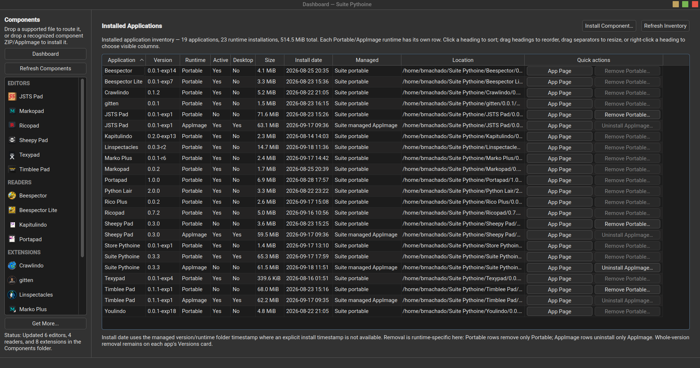
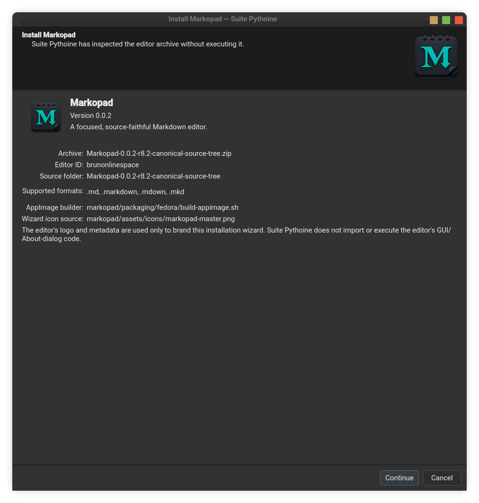
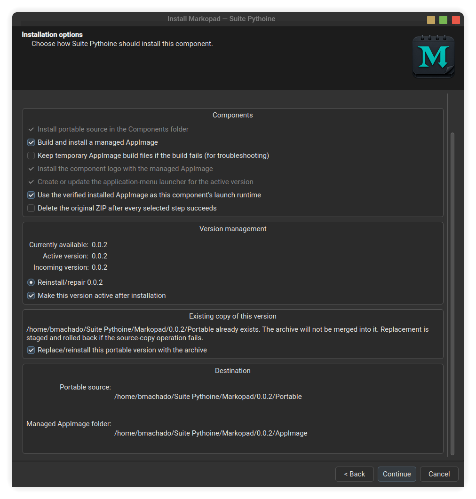
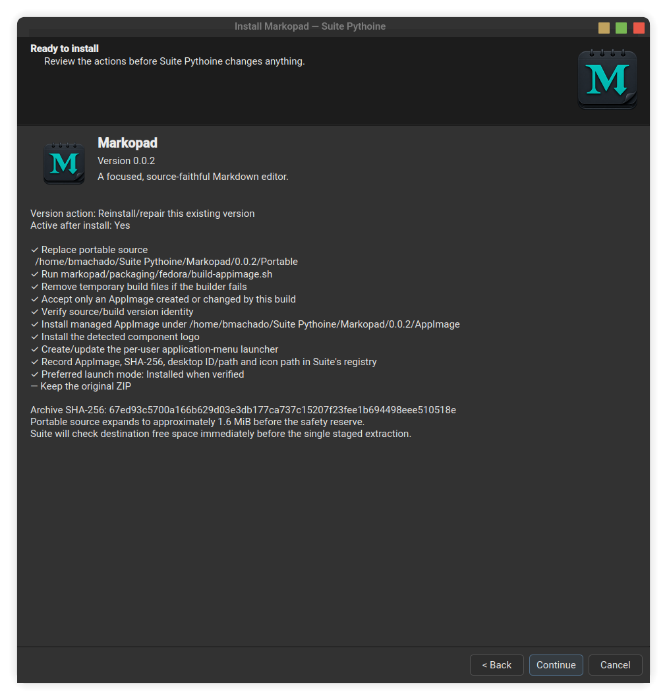
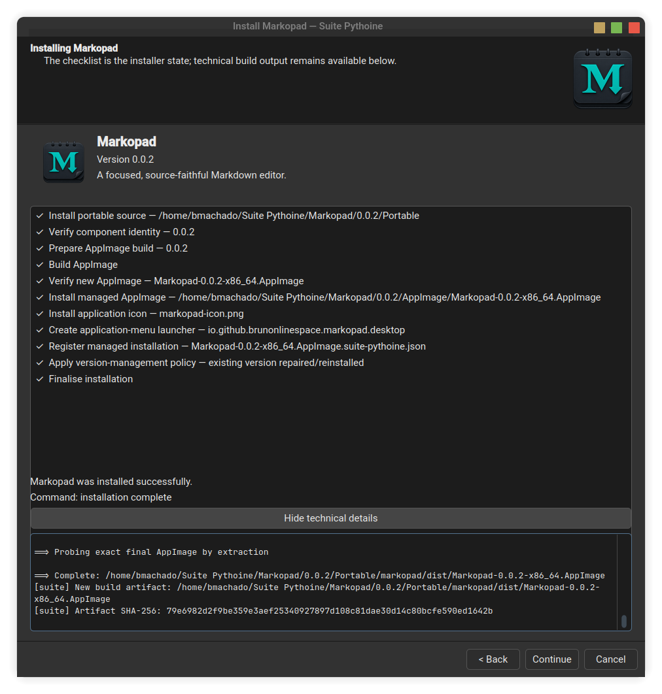
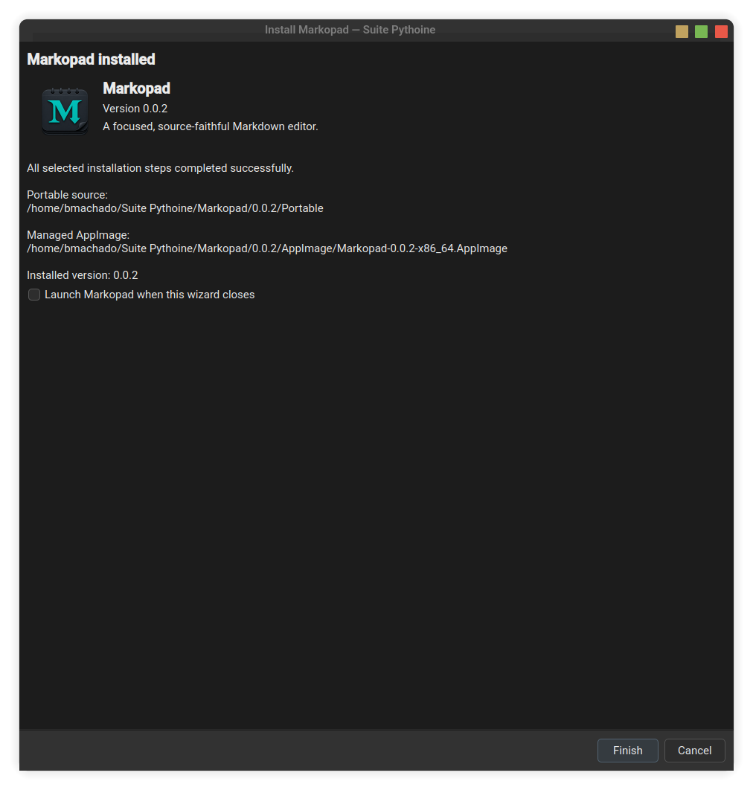

<p align="center">
  
</p>

# Suite Pythoine

**Your applications. Your files. One home.**

**Friendly. Fast. Focused.**

Suite Pythoine is a desktop application hub for the **brunonlinespace**
software family.

It brings together focused standalone applications, richer workspace
editions, portable and managed installations, file routing, component
discovery, and application management in one consistent interface.

The individual applications remain useful on their own. Suite Pythoine
simply gives them a shared home.

**Current release:** `1.0.0-x2.6`

**Repository:** https://github.com/brunonlinespace/suite-pythoine

---

## What is Suite Pythoine?

Suite Pythoine is designed around a simple idea:

> **Small applications should remain small applications — but they should
> still work beautifully together.**

Rather than turning every tool into one enormous program, Suite Pythoine
provides the common infrastructure around them:

- discover installed applications
- install supported components
- launch applications
- manage multiple installed versions
- open files with the appropriate application
- remember preferred file routes
- support portable and managed workflows
- expose application metadata and capabilities
- keep the component catalogue independently updateable

Applications remain free to run independently outside the Suite.

---

# Applications

Suite Pythoine brings together independently useful applications from the **brunonlinespace** family. Each keeps its own purpose and can run outside the Suite; the Hub provides shared discovery, installation, management and file routing where supported.

The index below groups the **current applications and companions** by purpose, following the compact, linked format of the LinSpectacles applet index. Historical catalogue identities are not listed as separate current products.

## Documents and workspaces

- **[MaqaronyDesk](https://github.com/brunonlinespace/maqaronydesk)** — Markdown workspace editor with folder navigation, dashboards, document tabs and source/preview views.
- **[MaqaronyPad](https://github.com/brunonlinespace/maqaronypad)** — Standalone Markdown editor with source-authoritative editing and a read-only rendered preview.
- **[Nuxpad 2](https://github.com/brunonlinespace/nuxpad)** — Lightweight general-purpose text editor for ordinary text, log and configuration files.
- **[RiqatonyDesk](https://github.com/brunonlinespace/riqatonydesk)** — Rich Text Format workspace editor with folder navigation, dashboards and persistent document tabs.
- **[RiqatonyPad](https://github.com/brunonlinespace/riqatonypad)** — Standalone RTF editor with a Ribbon interface, rich-text formatting and ordinary `.rtf` documents.

## Source editing and scripting

- **[JSTS Pad](https://github.com/brunonlinespace/jsts-pad)** — Focused JavaScript, TypeScript, JSX and TSX source editing with language-aware highlighting and an insertion Library.
- **[Python Lair](https://github.com/brunonlinespace/python-lair)** — Workspace for finding, editing, organising and launching ordinary Python scripts.
- **[Sheepy Pad](https://github.com/brunonlinespace/sheepy-pad)** — Python and shell-script editor and launcher with syntax-aware editing and execution controls.
- **[Texypad](https://github.com/brunonlinespace/texypad)** — LaTeX and BibTeX source editor with host TeX compilation and an integrated PDF print view.
- **[Timblee Pad](https://github.com/brunonlinespace/timblee-pad)** — HTML, CSS and XML-family source editor with templates, language-aware highlighting and browser preview.

## Reading and file inspection

- **[Beespector](https://github.com/brunonlinespace/beespector)** — Read-only binary and hexadecimal file inspection with metadata, signature analysis and exact two-file comparison.
- **[Beespector Lite](https://github.com/brunonlinespace/beespector-lite)** — Streamlined single-file read-only hex inspector without multi-file comparison.
- **[Kapitulindo](https://github.com/brunonlinespace/kapitulindo)** — EPUB reader with contents navigation, cross-chapter search and an optional personal book Library.
- **[Portapad](https://github.com/brunonlinespace/portapad)** — Focused PDF reader with document navigation, contents and search.

## Web, bookmarks and Git utilities

- **[Crawlindo](https://github.com/brunonlinespace/crawlindo)** — Website crawling and downloading utility.
- **[gitten](https://github.com/brunonlinespace/gitten)** — Git repository utility for the Pad application family.
- **[Sbookypad](https://github.com/brunonlinespace/sbookypad)** — Bookmark analysis and cleanup utility.
- **[Youlindo](https://github.com/brunonlinespace/youlindo)** — Standalone video downloader.

---

# A family, not a monolith

Suite Pythoine is intentionally **not** an attempt to merge every
brunonlinespace application into a single executable.

Instead:

```text
                    Suite Pythoine
                          │
          ┌───────────────┼───────────────┐
          │               │               │
        Pads            Desk          other families
          │               │               │
   focused apps     workspaces      specialist tools
          │               │               │
          └───────────────┴───────────────┘
                          │
                    shared ecosystem
```

The applications can evolve independently while still benefiting from
common discovery, routing and management infrastructure.

---

## Pads & Desk

The names describe different application roles.

| Family    | Meaning                                                      |
| --------- | ------------------------------------------------------------ |
| **Pad**   | A focused standalone application                             |
| **Desk**  | A Pad expanded with shared project/workspace infrastructure  |
| **Suite** | The hub connecting and managing the wider application family |

The distinction is intentional.

A Desk application does not replace its Pad counterpart.

```text
MaqaronyPad   → focused Markdown editor
MaqaronyDesk → Markdown workspace

RiqatonyPad    → focused RTF editor
RiqatonyDesk  → rich-text workspace
```

Users can choose whichever level of application they actually need.

---

# OS-level File routing

Suite Pythoine can integrate with OS and route supported files to applications that understand
them.

The component catalogue describes application capabilities rather than
forcing Suite Pythoine itself to understand every editor internally.

This allows components to evolve independently.

For example:

```text
.md / .markdown
        ↓
     MaqaronyPad

.rtf
        ↓
      RiqatonyPad

.html / .htm / .css
        ↓
    Timblee Pad
```

Users can also retain preferred routes where multiple applications
support the same kind of file.

---

# Component catalogue

Suite Pythoine uses a trusted component catalogue to describe supported
applications.

The catalogue can contain information such as:

* component identity
* display name
* publisher
* supported formats
* capabilities
* installation sources
* repositories
* available versions
* routing information

Catalogue revisions can evolve independently of the main Suite
executable.

That means adding or updating supported software does not necessarily
require rebuilding the entire Hub.

## Store Pythoine

**Store Pythoine** is the catalogue and software-distribution companion
to Suite Pythoine.

It provides a natural home for discovering supported applications and
complements Suite Pythoine's installation and component-management
infrastructure.

```text
Store Pythoine
      ↓
discover / obtain applications

Suite Pythoine
      ↓
install / manage / launch / route files
```

---

# Portable and managed applications

One of the central goals of Suite Pythoine is to support more than one
way of running software.

Depending on the component, applications may be available as:

* source distributions
* portable applications
* AppImages
* managed installations

Suite Pythoine offers a very convenient way to build and store AppImage
for most of brunonlinespace software, through a single shared source.

A standalone application should not have to surrender its independence
simply because it can also be managed by Suite Pythoine.

---

# Gallery

**Suite Pythoine - Dashboard and application Details page**

<p align="center">
  
  
  
</p>


**Integrated AppImage Builder for brunonlinespace software**

<p align="center">
  
  
  
  
  
</p>

---

# Design philosophy

The brunonlinespace applications share a few recurring ideas.

### Focused applications

A program should have a clear purpose.

If two jobs make more sense as two applications, they do not need to be
forced together.

### Consistency without sameness

Applications share familiar conventions, workflows and visual language
where appropriate, while preserving the controls needed by their
particular document type or task.

### Standalone first

Applications should remain genuinely usable independently.

Suite integration is an enhancement, not a dependency.

### Portable where practical

Being able to carry an application, run another version alongside the
current one, or avoid unnecessary installation is treated as a useful
capability rather than an afterthought.

### Friendly. Fast. Focused.

The software should be approachable, responsive and concentrated on the
job in front of the user.

---

# Another ecosystem

Suite Pythoine is designed to accommodate a growing collection of
specialist applications and families.

This includes **LinSpectacles**, the Linux inspection family.

## LinSpectacles

The Linux inspection family is developed as its own distinct project
family while remaining compatible with the wider Pythoine ecosystem.

**LinSpectacles**

> **Expose. Explore. Explain.**

LinSpectacles consists of specialist Linux inspection tools and applets
designed around focused sources and focused outputs.

The family can remain independently developed and distributed while
Suite Pythoine provides a bridge for discovery, installation and
launching.

Repository: [https://github.com/linspectacles](https://github.com/linspectacles)

---

# Project status

Suite Pythoine is under active development.

Cross-OS support is a big development milestone to achieve. Nuxpad
works both on Linux and Windows. Many other brunonlinespace apps will follow.

Interfaces, catalogue capabilities and component support continue to
evolve as the wider application family grows.

The project favours deliberate incremental development over attempting
to turn the Suite into an all-purpose desktop environment.

Website: [pythoine.neocities.org](https://pythoine.neocities.org/)

---

# Author

**[brunonlinespace (Bruno G. Machado)](https://github.com/brunonlinespace/)**

Suite Pythoine and the surrounding software family are independent
open-source projects created under the brunonlinespace identity.

Website: [brunonlinespace.neocities.com](https://brunonlinespace.neocities.com/)

---

# License

See the `LICENSE` file included with the source distribution for the
licence applicable to this repository.

Individual applications distributed through or recognised by
Suite Pythoine may have their own licensing information and remain
independently maintained projects.

---

<p align="center">
  <strong>Suite Pythoine</strong><br>
  Friendly. Fast. Focused.
</p>
